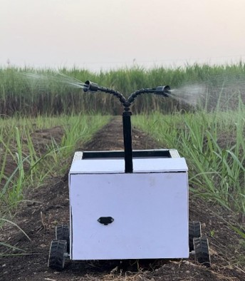

# Automated Hand Controlled Spraying Bot

### A Low-Cost Agricultural Spraying Rover with ESP32-Based Wireless Control and an Experimental Electrostatic Spraying System

<!-- Add your project photograph here -->
<!--  -->
# Automated Hand Controlled Spraying Bot

<p align="center">
  
</p>

## Overview

The **Automated Hand Controlled Spraying Bot** is a low-cost agricultural robotic system developed to reduce the physical effort and direct chemical exposure associated with conventional pesticide spraying.

The project integrates mechanical design, embedded electronics, wireless communication, fluid handling, and experimental electrostatic technology into a mobile agricultural rover.

The rover is controlled through a mobile application connected to an ESP32-based Wi-Fi access point. It uses geared DC motors for mobility and a 12V DC pumping system to deliver pesticide solution through a four-port spray nozzle. An additional dome-shaped electrostatic charging chamber, incorporating four copper electrode plates and a high-voltage generator, was designed and integrated into the spraying line to investigate electrostatic charging of the spray solution.

The prototype was designed for agricultural operation, including movement over uneven ground while carrying a pesticide storage tank.

## Project Objectives

- Develop a low-cost, mobile agricultural spraying platform.
- Reduce manual effort and direct operator exposure during pesticide application.
- Implement wireless rover control using an ESP32 microcontroller.
- Integrate motorized mobility with a controlled pesticide pumping system.
- Design and fabricate an experimental electrostatic charging chamber.
- Evaluate spray distribution through field testing and MATLAB-based image processing.

## Key Features

- **Wireless Mobile Control:** Wi-Fi-based communication between a mobile application and the ESP32 controller.
- **Motorized Mobility:** 12V geared DC motors with 120 mm wheels for movement across agricultural terrain.
- **Controlled Spraying:** Relay-operated 12V DC pump and four-port nozzle arrangement.
- **Simultaneous Operation:** Forward movement and automatic pump activation can operate together.
- **Experimental Electrostatic Chamber:** Dome-shaped enclosure with four copper electrode plates and a high-voltage generator.
- **Image-Based Evaluation:** MATLAB image processing to identify leaf regions and estimate spray coverage.
- **Low-Cost Prototype:** Reported project cost below ₹8,000.

## System Architecture

The project consists of five primary subsystems:

1. **Mechanical System**
   - Rover frame and structural assembly.
   - Geared DC motors and wheels.
   - Pesticide storage tank and component mounting.

2. **Electrical and Control System**
   - ESP32 DevKit V1.
   - Motor driver and relay module.
   - 12V battery-powered electrical system.

3. **Wireless Communication**
   - ESP32 configured as a Wi-Fi access point.
   - Mobile application communication through HTTP requests.
   - Single-character command-based control.

4. **Pesticide Spraying System**
   - 12V DC pump.
   - Liquid delivery pipes.
   - Four-port spray nozzle.

5. **Experimental Electrostatic System**
   - Dome-shaped charging enclosure.
   - Four copper electrode plates.
   - High-voltage generator.
   - Liquid inlet and outlet arrangement.

## Hardware Components

| Component | Specification / Description |
|---|---|
| Main Controller | ESP32 DevKit V1 |
| Drive Motors | 12V Johnson geared DC motors |
| Motor Speed | 100 RPM |
| Wheels | 120 mm diameter |
| Power Supply | 12V battery |
| Pump | 12V DC motor pump |
| Pump Switching | 4-channel 12V relay module |
| Spray Mechanism | Four-port nozzle |
| Storage Tank | 20-litre pesticide container |
| Electrostatic Chamber | Dome-shaped enclosure |
| Electrodes | Four copper plates |
| Charging Source | High-voltage generator |

## Working Principle

The ESP32 acts as the central controller of the rover. It creates a Wi-Fi access point with the SSID **Farm** and runs a web server on port 80.

The mobile application connects to this network and sends HTTP requests containing single-character commands. The ESP32 interprets these commands and controls the motor driver and pump relay.

### Operating Sequence

1. The 12V battery supplies electrical power to the system.
2. The ESP32 establishes the wireless connection with the mobile device.
3. The operator sends movement commands through the application.
4. The motor driver controls the direction of the geared DC motors.
5. When forward movement is commanded, the pump is automatically activated.
6. The pump draws liquid from the storage tank and delivers it through the spraying assembly.
7. The liquid passes through the experimental electrostatic chamber before reaching the spray nozzle.
8. The four-port nozzle distributes the liquid towards the target crop region.

## Mobile Control Commands

| Command | Rover Action | Pump State |
|---|---|---|
| F | Forward | ON (Automatic) |
| I | Forward-right | ON (Automatic) |
| G | Forward-left | ON (Automatic) |
| B | Backward | OFF |
| R | Turn right | OFF |
| L | Turn left | OFF |
| J | Backward-right | OFF |
| H | Backward-left | OFF |
| W | Manual pump control | ON |
| w | Manual pump control | OFF |
| S | Stop | OFF |

## Experimental Electrostatic Spraying Chamber

A dome-shaped electrostatic chamber was designed to investigate the application of electrical charging in agricultural spraying.

The chamber incorporates four copper electrode plates arranged around the liquid passage. A high-voltage generator supplies electrical potential to the electrode arrangement. The pesticide solution is delivered from the pump through the chamber and then transferred towards the spray nozzle.

The design focuses on:

- Compact chamber construction.
- Copper electrode positioning and spacing.
- Liquid inlet and outlet arrangement.
- Electrical insulation and separation.
- Mechanical stability and accessibility for maintenance.

**Experimental status:** The chamber was designed, fabricated, and integrated into the spraying system. However, the prototype experienced charging-related issues. Therefore, consistent electrostatic charging and improvements in droplet deposition require further investigation and experimental validation.

## Software and Engineering Tools

| Tool | Application |
|---|---|
| Arduino IDE | ESP32 programming |
| MATLAB | Leaf image processing and spray coverage analysis |
| SolidWorks | Mechanical CAD design |
| CATIA V5 | 3D modelling and design |
| ANSYS | Engineering analysis |
| Proteus | Circuit design and simulation |
| 3D Printing | Electrostatic chamber fabrication |

## Testing and Results

The prototype was tested for rover mobility, spraying operation, and performance on agricultural terrain.

The report documents the following observations:

- Stable rover movement on uneven agricultural ground.
- Operation with an approximate loaded weight of 25 kg.
- Simultaneous operation of the rover and pesticide pump during forward movement.
- A consistent spray pattern from the four-port nozzle.
- Wireless operation through the ESP32 and mobile application.

### MATLAB-Based Spray Coverage Analysis

MATLAB image processing was used to identify leaf regions, detect deposited spray regions, and calculate the percentage of spray coverage.

| Test Sample | Measured Spray Coverage |
|---|---:|
| Leaf Sample 1 | 24.77% |
| Leaf Sample 2 | 32.75% |
| **Average** | **28.76%** |

The average coverage obtained from the two analysed leaf samples was approximately **28.76%**.

These values represent the analysed samples and should not be interpreted as a general field-wide coverage or a proven improvement over conventional spraying.

## Project Methodology

The project was developed through the following stages:

1. Problem identification and concept definition.
2. Study of existing agricultural spraying systems.
3. Mechanical design and component selection.
4. Motor torque estimation and power-system planning.
5. Fabrication and assembly of the rover.
6. Development of the ESP32-based wireless control system.
7. Integration of the pump and four-port spraying mechanism.
8. Design and fabrication of the electrostatic charging chamber.
9. Prototype testing and field observations.
10. MATLAB-based spray coverage analysis.

## Limitations and Future Scope

The current prototype establishes a foundation for mobile agricultural spraying, but several areas require further development.

- Improve the reliability and effectiveness of the electrostatic charging arrangement.
- Investigate and validate actual droplet charging using suitable measurement methods.
- Conduct comparative tests between conventional and electrostatic spraying.
- Improve spray coverage measurement using more controlled imaging conditions.
- Introduce adjustable pump flow and spray pressure control.
- Improve electrical protection, enclosure safety, and system reliability.
- Explore autonomous navigation and crop-row detection.
- Evaluate chemical consumption and deposition under repeatable field conditions.

## Repository Structure

```text
Automated-Hand-Controlled-Spraying-Bot/
│
├── README.md
├── LICENSE
├── .gitignore
│
├── 01_Documentation/
│   ├── Project_Report/
│   ├── Research_Papers/
│   └── Presentations/
│
├── 02_Mechanical_Design/
│   ├── CAD_Models/
│   ├── 2D_Drawings/
│   ├── Chassis/
│   └── Electrostatic_Chamber/
│
├── 03_Electronics/
│   ├── Circuit_Diagrams/
│   ├── Wiring_Diagrams/
│   └── Component_Datasheets/
│
├── 04_Firmware/
│   └── ESP32_Controller/
│       ├── src/
│       ├── include/
│       └── platformio.ini
│
├── 05_Electrostatic_System/
│   ├── CAD_Design/
│   ├── Fabrication/
│   └── Testing/
│
├── 06_MATLAB_Analysis/
│   ├── Source_Code/
│   ├── Input_Images/
│   ├── Processed_Images/
│   └── Results/
│
├── 07_Testing_and_Results/
│   ├── Field_Testing/
│   └── Performance_Analysis/
│
└── 08_Media/
    ├── Images/
    └── Videos/
```

*This structure is a proposed organization for the repository. Files and folders will be added as the corresponding project assets are uploaded.*

## Project Information

**Project:** Automated Hand Controlled Spraying Bot

**Project Domain:** Agricultural Robotics and Mechatronics

**Controller:** ESP32 DevKit V1

**Communication:** Wi-Fi / HTTP

**Programming Environment:** Arduino IDE

**Analysis Tool:** MATLAB

---

*Developed as a mechatronics engineering project focused on agricultural automation, wireless robotic control, and experimental electrostatic spraying technology.*
